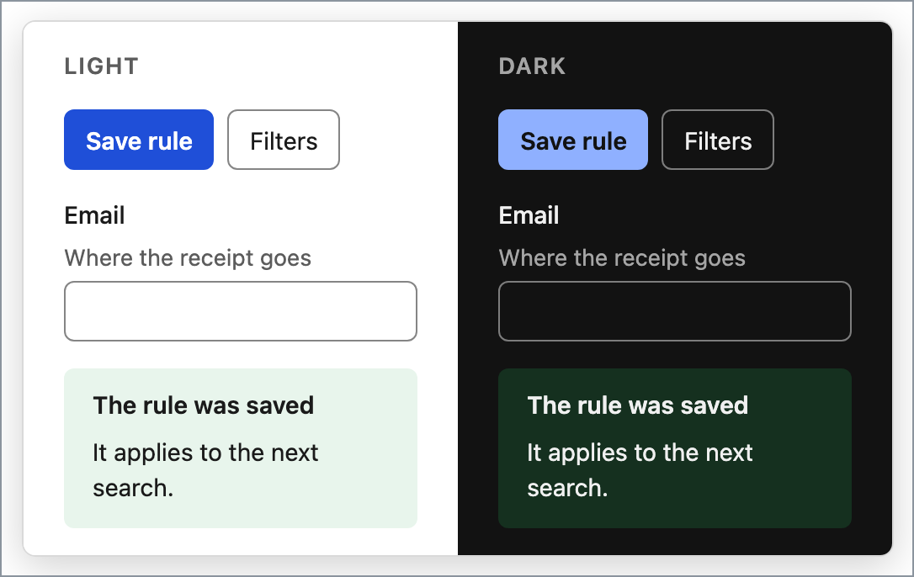

<p><a href="https://jasonsdevspace.com/design-kit/"><picture>
<source media="(prefers-color-scheme: dark)" srcset=".github/readme/mark-dark.svg">

</picture></a></p>

# design-kit

**A design system for a web page or a small app, with React or without it.**

It draws the portfolio at [jasonsdevspace.com](https://jasonsdevspace.com), and ShelfLens and Game
Table Tally are built on it. You get colors and type, a light and dark theme that follows the
visitor's choice, and ready-made pieces such as buttons, form fields, callouts, dialogs, a tab bar
and page layouts. Each piece is built to work by keyboard and screen reader. It ships on npm as
`@jasonsdevspace/design-kit`.

**[See every piece live](https://jasonsdevspace.com/design-kit/)** ·
[Read how it works](https://jasonsdevspace.com/design-kit/how-it-works/) ·
[Install it from npm](https://www.npmjs.com/package/@jasonsdevspace/design-kit) ·
[Read the reference](packages/design-kit/REFERENCE.md)

<a href="https://jasonsdevspace.com/design-kit/"></a>

## Why I built it

My demos each carried their own copy of the same things. ShelfLens and inventory-reservations
shipped the same script to set the visitor's theme, line for line, and each named its colors its own
way. A change to how a theme is chosen had to be made in every repository, and every new demo would
have copied it again. I wanted one package a demo could load beside its own styles, with neither
side overruling the other. ShelfLens now draws from the published package, pinned to one version.
These are what it promises, and since a style that quietly loses to another one shows no error, each
is held by a test.

- **A page's own styles win.** The kit never fights the page it sits in, so a demo can load it
  beside the styles it already has. The one thing it holds over a page is the reduced-motion rule,
  for a visitor who asks for less.
- **The theme never flashes.** A visitor's light or dark choice on the portfolio is set before a
  demo draws anything.
- **Each promise has a test.** The default colors are measured for contrast in both themes, and
  every page of the site is checked for accessibility and speed on each change.

## A path through the site

Start at [the home page](https://jasonsdevspace.com/design-kit/). The theme switch in the strip
saves the same choice the portfolio does, so it holds across jasonsdevspace.com.

- **[Tokens and theme](https://jasonsdevspace.com/design-kit/tokens/)** shows every color role in
  both themes and the contrast of each pairing it is meant for.
- **[Controls](https://jasonsdevspace.com/design-kit/controls/)** shows buttons, fields, steppers,
  callouts and dialogs in every state, with the code that draws each.
- **[App pieces](https://jasonsdevspace.com/design-kit/app-pieces/)** shows the frame, dock, tab
  bar, grids, rows and tables of a phone app.
- **[Layouts](https://jasonsdevspace.com/design-kit/layouts/)** shows the content page, bands with a
  hero, groups of sections, stacks and split rows a page is laid out with.
- **[Page chrome](https://jasonsdevspace.com/design-kit/page-chrome/)** shows the skip link, strip
  and footer around a demo.
- **[Explainer pieces](https://jasonsdevspace.com/design-kit/explainer-pieces/)** holds the layout
  of the page that says how a demo works.
- **[How it works](https://jasonsdevspace.com/design-kit/how-it-works/)** is that page written for
  the kit itself.
- **[The pieces together](https://jasonsdevspace.com/design-kit/together/)** stacks the newer pieces
  as an app's home page stacks them, each set apart from the one it sits on.
- **[Behavior](https://jasonsdevspace.com/design-kit/behavior/)** shows a refused form, a busy
  button, the arrow keys through a grid, focus moved after a change and a part of the page that
  loads, each working with what it says on its status line.
- **[A page's own palette](https://jasonsdevspace.com/design-kit/own-palette/)** shows a page drawn
  in its own colors and column, with its rules in a layer after the kit's.

The rest of this page is for engineers.

## Using it

[](https://www.npmjs.com/package/@jasonsdevspace/design-kit)

```sh
npm install --save-exact @jasonsdevspace/design-kit
```

> [!IMPORTANT]
> Before 1.0.0 a patch can carry Upgrading notes, so the install pins one exact version and a site
> moves to a new one once those notes are read.

A page loads the sheets, tokens first, through a bundler that resolves package exports, such as
Vite. A Vite build takes the theme script from the plugin, which puts it inline where the page's
head holds `<!-- theme-script -->`, and its browser target from the kit.

```css
@import '@jasonsdevspace/design-kit/tokens.css';
@import '@jasonsdevspace/design-kit/base.css';
@import '@jasonsdevspace/design-kit/components.css';
```

```ts
import { browserFloor, themeScriptPlugin } from '@jasonsdevspace/design-kit/vite';
import { defineConfig } from 'vite';

export default defineConfig({
    plugins: [themeScriptPlugin()],
    build: { target: browserFloor() },
});
```

[The package README](packages/design-kit/README.md) covers the rest of setup and [what each entry
exports](packages/design-kit/README.md#what-it-exports). [The
reference](packages/design-kit/REFERENCE.md) gives the markup, rules and React props for [the page
chrome](packages/design-kit/REFERENCE.md#page-chrome), [buttons, fields and
callouts](packages/design-kit/REFERENCE.md#buttons-fields-and-callouts) and [explainer
pages](packages/design-kit/REFERENCE.md#explainer-pages). It also covers [layers and
palettes](packages/design-kit/REFERENCE.md#layers-and-palettes), including how a page with layers of
its own names where the kit's go, and [the theme
contract](packages/design-kit/REFERENCE.md#the-theme-contract).

The writing rules the repository's comments, docs and pages follow come from
[`@jasonsdevspace/prose-check`](https://www.npmjs.com/package/@jasonsdevspace/prose-check),
installed at an exact pin. Its first version was published from this repository, and the package
now lives in [jasonsdevspace/tooling](https://github.com/jasonsdevspace/tooling), where a fix to its
rules goes.

## Browser support

The color roles are written with `light-dark()`, which sets the floor: Chrome and Edge 123, Firefox
120 and Safari 17.5. Cascade layers and `:where()` are older than that. A Vite build takes the
floor from the kit with `browserFloor()`, so its sheets keep each `light-dark()` as written. A page
that compiles its CSS with Lightning CSS passes `lightningcssFloor()` to it as well, since Vite
otherwise gives that transformer lower targets of its own, as
[the package README](packages/design-kit/README.md#browser-support) shows. What falls short at the
floor, and what no test here covers, is under
[known limitations](docs/ACCESSIBILITY.md#known-limitations).

## The gotchas, and the test behind each

Each promise the kit makes is held by a test. These are the ones a page leans on most, and the rest
follow by area. Each test links to its file, and a path that does not start with `packages/site/` is
under `packages/design-kit/`.

| Gotcha                                                                                                    | Where it is tested                                                   |
| --------------------------------------------------------------------------------------------------------- | -------------------------------------------------------------------- |
| A page's own rule outside a layer wins, however little it weighs, and a kit piece marked `hidden` is gone | [`e2e/sheets.spec.ts`](packages/design-kit/e2e/sheets.spec.ts)       |
| Every measured pairing passes its WCAG ratio in both themes                                               | [`src/tokens.test.ts`](packages/design-kit/src/tokens.test.ts)       |
| The theme is set before the body is parsed                                                                | [`e2e/theme.spec.ts`](packages/design-kit/e2e/theme.spec.ts)         |
| A button and a field stand level, at the field height wide and the target on a phone                      | [`e2e/controls.spec.tsx`](packages/design-kit/e2e/controls.spec.tsx) |
| A build that takes the kit's floor keeps each `light-dark()` as written, with either CSS transformer      | [`src/vite.test.ts`](packages/design-kit/src/vite.test.ts)           |
| Every page of the site meets the Lighthouse gates ShelfLens is held to                                    | `packages/site/bench/lighthouse.ts`                                  |

<details>
<summary>Cascade layers, weight and contrast</summary>

| Gotcha                                                                                                    | Where it is tested                                                               |
| --------------------------------------------------------------------------------------------------------- | -------------------------------------------------------------------------------- |
| A page's layers placed before the kit's lose to it unless they name `dk` first                            | [`e2e/sheets.spec.ts`](packages/design-kit/e2e/sheets.spec.ts)                   |
| Each rule is in its own dk layer, and only a class, a focus rule or an allowed pseudo-element adds weight | [`src/scope.test.ts`](packages/design-kit/src/scope.test.ts)                     |
| Every rule past the page chrome sits in a `:where()`, the explainer's layout included                     | [`src/scope.test.ts`](packages/design-kit/src/scope.test.ts)                     |
| A page's `::before` and `::after` take the border box                                                     | [`e2e/sheets.spec.ts`](packages/design-kit/e2e/sheets.spec.ts)                   |
| Reduced motion reaches `::before`, `::after`, `::backdrop` and a view transition                          | [`e2e/sheets.spec.ts`](packages/design-kit/e2e/sheets.spec.ts)                   |
| Reduced motion cuts a page's important transition, unlayered or layered after the kit                     | [`e2e/sheets.spec.ts`](packages/design-kit/e2e/sheets.spec.ts)                   |
| A palette set on a container restyles only what is inside it                                              | [`e2e/sheets.spec.ts`](packages/design-kit/e2e/sheets.spec.ts)                   |
| The focus ring is drawn in the accent, and not on a section a skip link moves focus to                    | [`e2e/sheets.spec.ts`](packages/design-kit/e2e/sheets.spec.ts)                   |
| A label hidden from the eye is still read by a screen reader                                              | [`e2e/sheets.spec.ts`](packages/design-kit/e2e/sheets.spec.ts)                   |
| A link in running text is underlined in both themes and forced colors, and a linked piece is not          | [`e2e/links.spec.ts`](packages/design-kit/e2e/links.spec.ts)                     |
| Text, the accent and a control's edge pass on the highlight and each callout's ground                     | [`src/tokens.test.ts`](packages/design-kit/src/tokens.test.ts)                   |
| Each root token is in the design tokens file in both themes, or named with why the format cannot hold it  | [`src/tokens.resolver.test.ts`](packages/design-kit/src/tokens.resolver.test.ts) |
| A rule on the root reads its lengths in em, since Safari draws a root's own rem from 16px at any size     | [`src/scope.test.ts`](packages/design-kit/src/scope.test.ts)                     |

</details>

<details>
<summary>The theme script and the Vite plugin</summary>

| Gotcha                                                                                       | Where it is tested                                               |
| -------------------------------------------------------------------------------------------- | ---------------------------------------------------------------- |
| Nothing saved, `system`, an unknown value and refused storage follow the system              | [`e2e/theme.spec.ts`](packages/design-kit/e2e/theme.spec.ts)     |
| A browser that cannot report its scheme draws light or the saved theme, and hears other tabs | [`e2e/theme.spec.ts`](packages/design-kit/e2e/theme.spec.ts)     |
| The theme follows the system as it changes, while nothing is saved                           | [`e2e/theme.spec.ts`](packages/design-kit/e2e/theme.spec.ts)     |
| A choice saved in another tab, or storage cleared there, reaches the page                    | [`e2e/theme.spec.ts`](packages/design-kit/e2e/theme.spec.ts)     |
| A page restored by Back draws the theme saved while it was away                              | [`e2e/theme.spec.ts`](packages/design-kit/e2e/theme.spec.ts)     |
| A page in the dark theme prints the light values                                             | [`e2e/chrome.spec.tsx`](packages/design-kit/e2e/chrome.spec.tsx) |
| The key and themes are the portfolio's, and the tokens have a rule for each                  | [`src/theme.test.ts`](packages/design-kit/src/theme.test.ts)     |
| The script holds nothing that would end its element, and compiles                            | [`src/theme.test.ts`](packages/design-kit/src/theme.test.ts)     |
| A page with no placeholder, or with two, fails the build                                     | [`src/vite.test.ts`](packages/design-kit/src/vite.test.ts)       |
| The hash is of the script exactly as the plugin writes it                                    | [`src/vite.test.ts`](packages/design-kit/src/vite.test.ts)       |
| The floor both READMEs and the accessibility statement give is the one the kit gives a build | [`src/vite.test.ts`](packages/design-kit/src/vite.test.ts)       |

</details>

<details>
<summary>The React components</summary>

| Gotcha                                                                                        | Where it is tested                                             |
| --------------------------------------------------------------------------------------------- | -------------------------------------------------------------- |
| The chrome draws the markup a page without React writes, and opens no link in a new tab       | [`src/react.test.tsx`](packages/design-kit/src/react.test.tsx) |
| A button never submits unless a page says so, and an off one runs no click handler            | [`src/react.test.tsx`](packages/design-kit/src/react.test.tsx) |
| A toggle has `aria-pressed` whether on or off, and an action has none                         | [`src/react.test.tsx`](packages/design-kit/src/react.test.tsx) |
| A button hands its ref on to the `<button>` it draws                                          | [`src/react.test.tsx`](packages/design-kit/src/react.test.tsx) |
| Focus moved through a button's ref lands on the kit's button                                  | [`e2e/ref.spec.ts`](packages/design-kit/e2e/ref.spec.ts)       |
| A field's ref is typed as the `<input>` or `<select>` it draws, and one of another is refused | [`src/react.test.tsx`](packages/design-kit/src/react.test.tsx) |
| Focus moved through a field's ref, after the field is drawn again, lands on its control       | [`e2e/ref.spec.ts`](packages/design-kit/e2e/ref.spec.ts)       |
| A field lists only what it draws in `aria-describedby`, and is invalid only with an error     | [`src/react.test.tsx`](packages/design-kit/src/react.test.tsx) |
| A callout has a role only when the page asks, and its actions sit outside the message         | [`src/react.test.tsx`](packages/design-kit/src/react.test.tsx) |
| A live callout is drawn empty, and success, warning and danger say their tone in words        | [`src/react.test.tsx`](packages/design-kit/src/react.test.tsx) |

</details>

<details>
<summary>The page chrome in the browser</summary>

| Gotcha                                                                                             | Where it is tested                                               |
| -------------------------------------------------------------------------------------------------- | ---------------------------------------------------------------- |
| The strip is one row over its rule on a wide screen, and rows of links on a phone                  | [`e2e/chrome.spec.tsx`](packages/design-kit/e2e/chrome.spec.tsx) |
| A demo's switches sit beside the links on a wide screen, and on a row below them on a phone        | [`e2e/chrome.spec.tsx`](packages/design-kit/e2e/chrome.spec.tsx) |
| The strip keeps the room of switches on their way, at the height they give it at every width       | [`e2e/chrome.spec.tsx`](packages/design-kit/e2e/chrome.spec.tsx) |
| The skip link is out of sight until the keyboard reaches it, and lands on the content              | [`e2e/chrome.spec.tsx`](packages/design-kit/e2e/chrome.spec.tsx) |
| A skip link inside a positioned box stays out of sight and out of the way of a click until focused | [`e2e/chrome.spec.tsx`](packages/design-kit/e2e/chrome.spec.tsx) |
| The focused skip link is a box in forced colors, by an edge in the link's color                    | [`e2e/chrome.spec.tsx`](packages/design-kit/e2e/chrome.spec.tsx) |
| The footer's rule spans the page, and its text and the strip's links line up in the column         | [`e2e/chrome.spec.tsx`](packages/design-kit/e2e/chrome.spec.tsx) |
| The chrome's link to the current page stands apart by its weight, in each theme and forced colors  | [`e2e/chrome.spec.tsx`](packages/design-kit/e2e/chrome.spec.tsx) |
| The chrome has no axe findings in either theme, at both widths, on a demo and its explainer        | [`e2e/chrome.spec.tsx`](packages/design-kit/e2e/chrome.spec.tsx) |
| The chrome draws with no inline style, under a policy that allows styles only from its origin      | [`e2e/chrome.spec.tsx`](packages/design-kit/e2e/chrome.spec.tsx) |

</details>

<details>
<summary>Buttons, fields and callouts in the browser</summary>

| Gotcha                                                                                                | Where it is tested                                                   |
| ----------------------------------------------------------------------------------------------------- | -------------------------------------------------------------------- |
| Field text is 16px or more on a phone, and every control fits 320px wide                              | [`e2e/controls.spec.tsx`](packages/design-kit/e2e/controls.spec.tsx) |
| An off button stays in the tab order, and is drawn as a disabled one is                               | [`e2e/controls.spec.tsx`](packages/design-kit/e2e/controls.spec.tsx) |
| A pressed toggle has a thicker edge as well as a ground, and keeps its name                           | [`e2e/controls.spec.tsx`](packages/design-kit/e2e/controls.spec.tsx) |
| A field is named by its label, and described by its hint and then its error                           | [`e2e/controls.spec.tsx`](packages/design-kit/e2e/controls.spec.tsx) |
| The focus ring follows the keyboard, on the accent button and inside every callout                    | [`e2e/controls.spec.tsx`](packages/design-kit/e2e/controls.spec.tsx) |
| Pressed and off stay apart in forced colors, a callout keeps its edge, and the select's arrow returns | [`e2e/controls.spec.tsx`](packages/design-kit/e2e/controls.spec.tsx) |
| An empty live callout draws nothing, and takes the callout's look once it is filled                   | [`e2e/controls.spec.tsx`](packages/design-kit/e2e/controls.spec.tsx) |
| Fields side by side share a line where they fit and stack where they do not, every label whole        | [`e2e/fields.spec.tsx`](packages/design-kit/e2e/fields.spec.tsx)     |
| The controls have no axe findings in any state, in either theme, wide and on a phone                  | [`e2e/controls.spec.tsx`](packages/design-kit/e2e/controls.spec.tsx) |

</details>

<details>
<summary>The controls and hooks in the browser</summary>

| Gotcha                                                                                                      | Where it is tested                                                         |
| ----------------------------------------------------------------------------------------------------------- | -------------------------------------------------------------------------- |
| A form that fails its constraints is refused before the page's handler, with the kit's errors and no bubble | [`e2e/checked.spec.tsx`](packages/design-kit/e2e/checked.spec.tsx)         |
| Words a visitor must hear are not lost on a shared status line                                              | [`e2e/shared-line.spec.tsx`](packages/design-kit/e2e/shared-line.spec.tsx) |
| A view's heading takes focus only for a recent press, never for Tab or typing                               | [`e2e/focus.spec.tsx`](packages/design-kit/e2e/focus.spec.tsx)             |
| A grid and a tab row are one Tab stop moved by the arrows                                                   | [`e2e/roving.spec.tsx`](packages/design-kit/e2e/roving.spec.tsx)           |
| A busy button saves once however often it is pressed                                                        | [`e2e/busy.spec.tsx`](packages/design-kit/e2e/busy.spec.tsx)               |
| Each hook attaches a swapped element and sets nothing again on a redraw                                     | [`e2e/hooks.spec.tsx`](packages/design-kit/e2e/hooks.spec.tsx)             |
| A piece taken down leaves no listener, observer, timer or animation frame running                           | [`e2e/leaks.spec.tsx`](packages/design-kit/e2e/leaks.spec.tsx)             |

</details>

<details>
<summary>Explainer pages</summary>

| Gotcha                                                                                        | Where it is tested                                                     |
| --------------------------------------------------------------------------------------------- | ---------------------------------------------------------------------- |
| An explainer marks its link to how it works as the current page in the strip and the footer   | [`e2e/explainer.spec.tsx`](packages/design-kit/e2e/explainer.spec.tsx) |
| An explainer's text starts where the strip's links do, and holds to the measure               | [`e2e/explainer.spec.tsx`](packages/design-kit/e2e/explainer.spec.tsx) |
| A line of the lead and of body text runs to 80 characters or fewer on a wide screen           | [`e2e/explainer.spec.tsx`](packages/design-kit/e2e/explainer.spec.tsx) |
| A section opens with its rule, its number, its heading and then its text                      | [`e2e/explainer.spec.tsx`](packages/design-kit/e2e/explainer.spec.tsx) |
| The page never scrolls sideways at any width or text size, and only the frames do             | [`e2e/explainer.spec.tsx`](packages/design-kit/e2e/explainer.spec.tsx) |
| Nothing clips text spaced out as far as WCAG asks, on a phone                                 | [`e2e/explainer.spec.tsx`](packages/design-kit/e2e/explainer.spec.tsx) |
| Each frame is named by its title, and the keyboard reaches and scrolls it                     | [`e2e/explainer.spec.tsx`](packages/design-kit/e2e/explainer.spec.tsx) |
| A table reads by its column and row headers, with its figures set to the right                | [`e2e/explainer.spec.tsx`](packages/design-kit/e2e/explainer.spec.tsx) |
| Code keeps its lines whole, and inline code is a step under the text and breaks where it must | [`e2e/explainer.spec.tsx`](packages/design-kit/e2e/explainer.spec.tsx) |
| The skip link lands on the content, and an in-page link keeps its section's number in sight   | [`e2e/explainer.spec.tsx`](packages/design-kit/e2e/explainer.spec.tsx) |
| No section is a landmark, each frame is, and the steps stay a list                            | [`e2e/explainer.spec.tsx`](packages/design-kit/e2e/explainer.spec.tsx) |
| A panel sits on the card ground, with an edge that stays in forced colors                     | [`e2e/explainer.spec.tsx`](packages/design-kit/e2e/explainer.spec.tsx) |
| An explainer page has no axe findings in either theme, wide and on a phone                    | [`e2e/explainer.spec.tsx`](packages/design-kit/e2e/explainer.spec.tsx) |

</details>

<details>
<summary>The packed package and the markup the docs print</summary>

| Gotcha                                                                                                                                                       | Where it is tested                                                         |
| ------------------------------------------------------------------------------------------------------------------------------------------------------------ | -------------------------------------------------------------------------- |
| Each sheet resolves and each module loads from the packed package, on the oldest Node                                                                        | [`smoke/consumer.mjs`](packages/design-kit/smoke/consumer.mjs)             |
| The strip draws its markup from the packed package, with the React a page has                                                                                | [`smoke/consumer.mjs`](packages/design-kit/smoke/consumer.mjs)             |
| A field makes its ids with `useId` in a server render of the packed package                                                                                  | [`smoke/consumer.mjs`](packages/design-kit/smoke/consumer.mjs)             |
| Each block of a piece's markup in the reference is what its example draws                                                                                    | [`examples/readme.test.ts`](packages/design-kit/examples/readme.test.ts)   |
| Each state the site shows draws the attribute printed under it                                                                                               | [`examples/states.test.tsx`](packages/design-kit/examples/states.test.tsx) |
| Each state's React draws the state's own markup, laid out as the repository lays out code                                                                    | [`examples/states.test.tsx`](packages/design-kit/examples/states.test.tsx) |
| Each state's React draws what the version the site pins draws for the state                                                                                  | `packages/site/src/code.test.ts`                                           |
| The package exports what the smoke test loads and nothing else, has a changelog entry for its version, and packs its build, its README and its license alone | [`smoke/package.test.ts`](packages/design-kit/smoke/package.test.ts)       |

</details>

<details>
<summary>The showcase site</summary>

| Gotcha                                                                                                            | Where it is tested                    |
| ----------------------------------------------------------------------------------------------------------------- | ------------------------------------- |
| Every page of the site has no axe findings in either theme, on a phone and a wide screen                          | `packages/site/e2e/site.spec.ts`      |
| No page of the site scrolls sideways at any width or at twice the text size, or cuts off text under wider spacing | `packages/site/e2e/site.spec.ts`      |
| The site draws under `style-src 'self'`, its scripts the theme script by its hash and its own path                | `packages/site/e2e/site.spec.ts`      |
| The site draws the published kit at one exact version, and nothing from the kit's sources                         | `packages/site/src/published.test.ts` |
| The deployed policy allows scripts from the site's own path and the theme script's hash, never the whole origin   | `packages/site/src/policy.test.ts`    |
| A copy of a state in the other theme draws in that theme, and the keyboard never stops inside it                  | `packages/site/e2e/site.spec.ts`      |
| The tokens page draws each swatch in the value printed beside it, and lists every pairing tightest first          | `packages/site/e2e/site.spec.ts`      |
| The page chrome page draws each state as a picture, around the kit's own live chrome                              | `packages/site/e2e/site.spec.ts`      |
| The app pieces page draws the frame and the tab bar as pictures, and the grids, rows and table live               | `packages/site/e2e/site.spec.ts`      |
| The explainer pieces page draws each piece live, and the explainer's layout as a picture                          | `packages/site/e2e/site.spec.ts`      |
| The site's explainer marks itself the current page, and every other page's strip and footer lead to it            | `packages/site/e2e/site.spec.ts`      |
| Every link within the site leads to one of its pages, and to the id it names, where it names one                  | `packages/site/e2e/site.spec.ts`      |
| The theme switch shows and saves the portfolio's choice, follows another tab, and works without storage           | `packages/site/e2e/site.spec.ts`      |
| Each live state's code shows the markup its copy draws, and copies or selects it with the status saying which     | `packages/site/e2e/site.spec.ts`      |
| Each state's copies fill the column, both named, and its live toggle and panel change when pressed                | `packages/site/e2e/site.spec.ts`      |

</details>

## What was measured

**What the kit costs a page.** Each part a page can load is held by a test, gzipped, the sheets and
the controls without their comments.

| What a page loads                                       | Held to  |
| ------------------------------------------------------- | -------- |
| The three sheets                                        | 13.25 KB |
| The theme script, inline in the page's head             | 1 KB     |
| Every function of the controls, as a bundler sends them | 26 KB    |
| The controls' entry imported with no names              | 2.25 KB  |
| `attachTable` alone                                     | 3.5 KB   |
| `attachForm` alone                                      | 10.5 KB  |

A page that attaches a control loads the controls as well, and they ship in parts, so a bundler
sends a page only what it imports. The package npm publishes is 165 KB packed, the sheets and
modules a page loads together with the README, the types and the tokens in the design tokens format,
which it never does. [The record](docs/benchmarks/package-size.md) lists every file, raw and
gzipped, each sheet without its comments, and from 0.6.0 what each piece of the sheets and each
function of the controls costs.

**The site's pages.** On a first visit as Lighthouse makes one, a phone on a slow network with its
processor slowed, every page scores a hundred for accessibility and at least 99 for performance,
shows its main content in under a second with nothing jumping as it loads, and downloads 24.4 to
39.5 KB in four requests. CI fails any page under a hundred for accessibility or ninety for
performance, that takes longer than two and a half seconds to show its main content, whose layout
shifts by more than a tenth, or whose script or sheets, gzipped, pass the budgets in
`packages/site/src/budgets.ts`. [The record](docs/benchmarks/site-pages.md) gives each page.

## Decisions

Each choice with a real alternative is a record in [docs/decisions](docs/decisions), with the
options rejected, what the choice costs, and the test behind it.

<details>
<summary>The decisions behind the kit, and what each one costs</summary>

1. [The kit is a workspace, built on pack and installed from npm](docs/decisions/0001-a-workspace-built-on-pack.md).
   A demo installs what npm packs, with no script of the kit's to run, rather than
   building the kit from git with every tool the repository checks itself with.
2. [The kit's rules sit in dk layers, with a prefix and no weight](docs/decisions/0002-rules-sit-in-dk-layers.md).
   A page's own rule wins however plain it is, at the cost of a load order a page with layers of
   its own has to get right.
3. [Each color holds both themes in one light-dark()](docs/decisions/0003-one-light-dark-per-color.md).
   A palette is set in one place for both themes, at the cost of a browser floor and of anything
   but a color varying by theme.
4. [One theme contract with the portfolio, set before the first paint](docs/decisions/0004-one-theme-contract.md).
   The key, the themes and the script live in the kit, and a page that forgets the script fails its
   build, at the cost of a contract that holds only on the portfolio's origin.
5. [The components carry no stylesheet of their own](docs/decisions/0005-components-carry-no-stylesheet.md).
   The components draw markup and nothing else, so they load in plain Node and draw under
   `style-src 'self'`, at the cost of a sheet each page loads itself and markup a page without
   React has to keep to.
6. [A control's state is an attribute, and its rules weigh nothing](docs/decisions/0006-a-control-state-is-an-attribute.md).
   What a visitor sees and what a screen reader hears come from one attribute, and an off button
   keeps its focus, at the cost of a click handler a page without React has to write itself.
7. [A callout takes a role only when a page asks for one](docs/decisions/0007-a-callout-takes-a-role-only-when-asked.md).
   A message on the page when it loads is never read out of turn, at the cost of a page deciding
   for each message whether it is live.
8. [A frame that scrolls is always a named region](docs/decisions/0008-a-scroll-frame-is-always-a-region.md).
   A wide table or block of code scrolls inside a frame the keyboard reaches, with no script, at
   the cost of a tab stop on a wide screen where nothing scrolls.
9. [An explainer's sections are never landmarks](docs/decisions/0009-explainer-sections-are-never-landmarks.md).
   The page's landmarks stay few and a reader reaches a section by its heading, at the cost of no
   landmark stop at a section.
10. [The markup each piece draws lives in one module of examples](docs/decisions/0010-one-module-of-examples.md).
    The reference shows what the components draw, held to them by a unit test, at the cost of a
    command to run after each change to a piece's markup.
11. [The site is built with Vite and React's static render, with no script of React's](docs/decisions/0011-the-site-is-built-with-vite-and-a-static-render.md).
    The site draws the published kit under the policy a demo sets, with no runtime of a framework's,
    at the cost of a policy in a meta element, which cannot stop another site framing it, and of a
    change to the kit reaching the site a release later.
12. [The site has a script of its own, from its own path, beside the kit's theme script](docs/decisions/0012-the-site-has-a-script-of-its-own.md).
    A visitor chooses a theme on the site and it holds across jasonsdevspace.com, with nothing
    moving when the switch comes, at the cost of a policy written for jasonsdevspace.com alone, so
    a build served anywhere else, as the tests and the audit serve theirs, names its own origin.
13. [The kit's controls ship their behavior as a module a page attaches to their markup](docs/decisions/0013-controls-attach-to-markup.md).
    The theme switch, the copy button, the stepper, the toast and the dialog work the same on a page
    with React and one without, from one copy of their behavior, at the cost of a second script in
    the browser, held to a budget.
14. [A piece with no state of its own ships as classes alone](docs/decisions/0014-stateless-pieces-ship-as-classes.md).
    Tabs, pills and the eyebrow look the same on every site from classes a page writes, with their
    keys from `attachRoving`, at the cost of each page choosing the tab and drawing its panel
    itself.
15. [A toast's attach function returns what shows a message](docs/decisions/0015-a-toast-attach-returns-what-shows-a-message.md).
    A page attaches a toast once and calls one function for every message, which a screen reader
    hears with its way back, at the cost of the one control whose attach function takes nothing
    away.
16. [A page changes how a piece draws only through the properties it names](docs/decisions/0016-a-page-changes-how-a-piece-draws-only-through-the-properties-it-names.md).
    A page sets a tile's ground, a raised panel's shadow or a grid's width through a property the
    kit reads with a fallback, so its look survives the kit's changes, at the cost of the page
    keeping what sits on a ground it sets to its contrast.
17. [A content page is a container of its own](docs/decisions/0017-a-content-page-is-a-container.md).
    A landing or an about page spaces its blocks and sections and holds its prose to the measure
    with one class, at the cost of a change to the flow's step moving the explainer and the content
    page together.
18. [The tokens ship in the design tokens format, written by hand and held by a test](docs/decisions/0018-the-tokens-ship-in-the-design-tokens-format-written-by-hand.md).
    A tool that reads the format reads the kit's tokens from the package, and a token changed in
    one file and not the other fails a test, at the cost of a second public copy of the tokens'
    names, where renaming or dropping one is a breaking change.
19. [A closing panel hands focus to its button only where the visitor's place was in it](docs/decisions/0019-a-closing-panel-hands-focus-back-only-where-the-visitors-place-was-in-it.md).
    Focus comes back to the button when it was in the panel, in every engine Safari included, at
    the cost of a tabindex the kit writes on a panel's buttons, which makes them stops for Tab in
    Safari where the page's other buttons are not.
20. [The kit's React hooks wrap its attach functions](docs/decisions/0020-react-hooks-wrap-the-attach-functions.md).
    A React page attaches a form, a busy button, progress or a group of cells, and moves focus, with
    one hook over the same function a page without React calls, and draws the status line with
    `StatusProvider`, at the cost of `./react` importing `./controls`.
21. [A refused form checks the browser's constraints itself](docs/decisions/0021-a-refused-form-checks-the-browsers-constraints-itself.md).
    A form's native constraints are kept and its errors drawn in the kit's look and words, never the
    browser's bubble, at the cost of a page's own checks running only once the constraints pass.
22. [Every attach takes a signal that takes its piece down](docs/decisions/0022-every-attach-takes-a-signal-that-takes-its-piece-down.md).
    A page takes down any piece by aborting one signal, whatever its attach returns, with nothing
    left running and calls after it doing nothing, at the cost of the piece staying alive until its
    signal aborts, so a page hands over a signal that lives no longer than the piece.
23. [A control outlives a takedown and an attach in one task](docs/decisions/0023-a-control-outlives-a-takedown-and-an-attach-in-one-task.md).
    A hook's ref made afresh on every render, a merged ref and React's second run keep a control and
    its state, at the cost of a takedown landing a microtask after its abort, so a page that means
    to start afresh within the task calls the detach.
24. [A plain form spaces only the kit's blocks](docs/decisions/0024-a-plain-form-spaces-only-the-kits-blocks.md).
    A field, a row of fields, a row of actions and a filled callout in a form with no class each
    stand a step below the one before, and a page's own markup keeps its place, at the cost of a
    lone button written bare after a field sitting flush under it.
25. [A row of fields sizes each field by a length, never by its content](docs/decisions/0025-a-row-of-fields-sizes-each-field-by-a-length-never-by-its-content.md).
    Fields set side by side each start from one length and share the rest, so no label, hint or
    error moves the field beside it, at the cost of two fields stacking where the row is narrower
    than 21rem, a screen narrower than 368 pixels in a page's column, and a wider stepper asking
    the page for a wider length.
26. [A stepper is as tall as a field wherever it stands](docs/decisions/0026-a-stepper-is-as-tall-as-a-field-wherever-it-stands.md).
    A stepper's buttons and value take their height from the rules every button and field take
    theirs from, so a row's labels stand level on a wide page as on a phone, at the cost of a
    stepper 8 pixels shorter on a wide page outside an app, where a tall stepper keeps the larger
    target. Leaving it the target tall, a row that lines its fields up by their labels, a height of
    the stepper's own and buttons as wide as they are tall were turned down.
27. [A `:has()` on an element that holds the page is written only where the rule draws that element](docs/decisions/0027-a-has-on-an-element-that-holds-the-page-is-written-only-where-the-rule-draws-that-element.md).
    A change to a page restyles what it touches in Chrome, where it restyled every element, at the
    cost of a shown toast written by hand in a live frame keeping no room until the page marks the
    frame, and a dialog set apart from its frame saying so with a class.
28. [A read-only value of words is a textarea the kit sizes to its value](docs/decisions/0028-a-read-only-value-of-words-is-a-textarea-the-kit-sizes-to-its-value.md).
    A value a visitor reads but cannot change, drawn by `ValueField` or a read-only select, wraps
    and shows whole at twice the text size on a phone, at the cost of a screen reader calling it a
    text area, and of a long value scrolling inside one field's height where a browser cannot size
    a field to its content.
29. [F8 moves focus to a shown toast's action and back](docs/decisions/0029-f8-moves-focus-to-a-shown-toasts-action-and-back.md).
    A keyboard user reaches a toast's action, such as Undo, in one keystroke from anywhere and goes
    back where they were, at the cost of a key the kit names only to a screen reader, and only once
    focus is on the action, by its `aria-keyshortcuts`.

</details>

## Dev setup

How to contribute is in [CONTRIBUTING.md](.github/CONTRIBUTING.md), and what the kit holds itself
to for accessibility, and how to report a barrier, is in [ACCESSIBILITY.md](docs/ACCESSIBILITY.md).

You need [Node.js 24](https://nodejs.org/) and Git. The version is in `.nvmrc`, so `nvm use`
picks it.

```bash
git clone https://github.com/jasonsdevspace/design-kit.git
cd design-kit
npm ci
npm run prepare
npm run verify
```

`npm run verify` runs the type-check, lint, the format, prose, Node and install checks, and the unit
tests.
`npm run e2e` runs the browser tests in Chromium, and the specs `packages/design-kit/e2e/engines.ts`
names, each with the reason it runs there, in WebKit and Firefox too. `npm run lighthouse` builds
the site and audits every page against the gates CI holds it to. Nothing needs building first, since
the kit's tests read the sources and the site's tests build and serve the site themselves.
`npm run build` compiles the theme module, the controls, the plugin and the components into the
package's `dist`, beside a copy of each sheet, and builds the site. `npm run prepare` sets up the
hooks, which lint and format what is staged and check each commit message. It runs by name, since
the `.npmrc` turns npm's install scripts off and npm skips `prepare` with them.

```bash
npx playwright install chromium webkit firefox
npm run e2e
npm run lighthouse
```

The site in `packages/site` is built with `npm run site` and served under `/design-kit/` as GitHub
Pages serves it. It draws the kit as npm publishes it, at the version its `package.json` pins, so a
change to the kit reaches the site once it is released and the pin moves. A build to be served from
anywhere but jasonsdevspace.com names that origin in `SITE_ORIGIN`, or its policy refuses the theme
switch.

<details>
<summary>What CI checks on every pull request</summary>

CI runs the checks `npm run verify` runs, a check that the lockfile matches the manifests, and the
build in one job. Another packs the package, checks its manifest with publint, and installs it into
an empty project on the lowest Node its engines field admits, with install scripts off and no Vite,
where each sheet must resolve and each module load by the name a demo imports it by, then
type-checks a page's use of it as Node and as a bundler resolve it. The browser tests run in
Chromium in jobs that split them, and in WebKit, on a Mac, and in Firefox in more of them, as many
as each job's matrix lists. The site's tests run again over each commit's own packed kit in a job of
their own, so a change that would break the site fails before it is released. A gate named Browser
tests, the check the ruleset requires, passes only where the Chromium jobs and that run all passed.
The Lighthouse audit runs in a job of its own. Once every job passes on main, a job with read access
alone builds the site, and a job that runs only GitHub's Pages actions deploys it. Each job runs on
a named image, Ubuntu but for the WebKit jobs, within a time limit, which a test holds, and each
check writes what it found to its run's page on GitHub, from `scripts/summary.mjs`.

</details>

<details>
<summary>How a release reaches npm</summary>

A release is a tag on main named for the package's version, such as `design-kit-v0.1.0`. The tag,
the version in `packages/design-kit/package.json` and a heading for it in the package's
`CHANGELOG.md` have to agree, with no `## Unreleased` heading left, and nothing but its README may
be left in `packages/design-kit/changes`, or the release workflow stops. It runs every check CI
runs, then stages on npm, with provenance, the tarball the oldest Node job proved, and only if its
checksum is the one that job reported. Trusted publishing means no npm token is stored anywhere, and
a staged version goes live only when it is promoted on the package page. The job that stages
installs nothing but a pinned npm, checked against the checksum npm's registry gives for it, and
fetches nothing else. A version with a hyphen is staged under npm's `next` tag and marked as a
prerelease on GitHub, and each release has a GitHub release with its changelog entry as the notes.
The steps a maintainer takes around a release are in
[CONTRIBUTING.md](.github/CONTRIBUTING.md#releasing).

</details>

<details>
<summary>Recording the benchmarks</summary>

`npm run bench:package` records what the package weighs, and `npm run bench:pages` records how each
page scores through the same audit `npm run lighthouse` runs, writing only when every page passes.
Each record sits in `docs/benchmarks` beside its raw results, with the date, commit, machine and
Node it ran on, and a recording run refuses a working tree with uncommitted changes, so the commit
it names is the code it measured. The release workflow records the package from each stable
version's tagged commit, which is on main. The site pages workflow records the pages from the commit
on main that moves the site's pin, since the pin is what changes what the pages draw, and at the tag
the site still draws from the version before. A run by hand records them where the record names
another version than the site pins, as after a run that failed. Each opens a pull request with its
record, with a token from the records app, since a pull request opened with the run's own token runs
no other workflow. To measure a change before it ships, run `npm run lighthouse`, which audits the
same pages and writes no record.

```bash
npm run bench:package
npm run bench:pages
```

</details>

## Project layout

<details>
<summary>What each folder holds</summary>

- `packages/design-kit/` holds the package, its npm README and the reference.
    - `src/` holds the sheets and a JSON of the tokens, the scripts, the React components and their
      tests.
    - `examples/` holds the markup the reference prints and the site shows, and its tests.
    - `e2e/` holds the browser tests.
    - `smoke/` installs the packed package as a page would install it.
- `packages/site/` holds the site at jasonsdevspace.com/design-kit/, its browser tests and audit.
- `scripts/` holds the Node check, the site's kit check, the run summaries, the benchmark writer
  and the tests that read the whole repository.
- `docs/` holds the accessibility statement in `ACCESSIBILITY.md`, the benchmarks in `benchmarks/`,
  which say what the package weighs and how the site's pages score, and the decision records in
  `decisions/`.
- `.github/` holds the contributing guide in `CONTRIBUTING.md`, the security policy in
  `SECURITY.md`, the issue templates for a piece of work, a parent issue and a bug in
  `ISSUE_TEMPLATE/`, the pull request template in `pull_request_template.md`, the README's mark and
  picture in `readme/`, the monthly dependency and action updates in `dependabot.yml`, and CI and
  deploy, release, the site's records, the dependency cache and the pull request check in
  `workflows/`.

</details>

## License

MIT. See [LICENSE](LICENSE).
